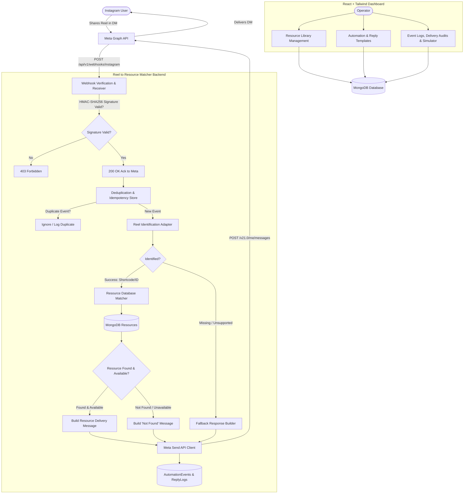

# Reel to Resource Matcher — System Architecture & Reuse Analysis

## 1. Executive Summary

**Reel to Resource Matcher** is a focused, self-hostable automation platform engineered for a single primary workflow:
> **Instagram Direct Message containing a shared Reel → Identify the Reel → Search internal MongoDB resource database → Reply with the associated resource link (or a configurable fallback).**

This document details the evaluation of existing open-source solutions, justifies our architectural decisions, and outlines the system architecture.

---

## 2. Investigation of Existing Open-Source Repositories

In accordance with our project charter, three open-source repositories were thoroughly evaluated prior to implementation:

| Repository | Focus & Capabilities | Tech Stack | Evaluation & Reuse Decision |
| :--- | :--- | :--- | :--- |
| **OpenReply** `diwenne/openreply` | Instagram Comment-to-DM automation tool designed as a ManyChat alternative. Listens to `comments` webhooks; triggers automated private replies when users comment a keyword (e.g., "LINK"). | TypeScript, PostgreSQL (Prisma), Redis, BullMQ | **Rejected for base:** OpenReply is built entirely around comment campaign workflows and keyword triggers. It requires PostgreSQL and Redis (violating our requirement for a minimal, single-backend MongoDB deployment). Most critically, it does **not** identify or parse shared Reel attachments or match them against a resource library. |
| **InstaAuto** `ayuuxh2/insta-p8` | Instagram growth platform for comment-to-DM funnels, story engagement, and AI-driven responses. | Next.js, Supabase (PostgreSQL), OpenAI | **Rejected for base:** Heavily centered on AI auto-replies, story interactions, and Supabase. Relies on AI hallucinations instead of exact deterministic resource matching, and does not parse Reel share payloads. |
| **BrightBean Chat** `brightbeanxyz/brightbean-chat` | Multi-channel visual chatbot flow builder supporting WhatsApp, Messenger, Telegram, SMS, and Instagram. | Python, Django/FastAPI | **Rejected for base:** Disproportionately large multi-channel chatbot suite in Python. Outside the project's technology requirements (Node.js/TypeScript/Express/React) and unnecessarily complex for a single-purpose Reel-to-Resource matcher. |

### Conclusion on Existing Codebases
None of the existing tools support the native **Instagram Reel-Share DM → Identifier Extraction → Database Resource Match** pipeline. Adapting an existing comment-automation or multi-channel bot codebase would introduce significant technical debt, complex unused dependencies (Redis, BullMQ, multi-channel flow builders, comment tracking), and database mismatches (PostgreSQL instead of MongoDB).

Therefore, we implement a **clean, clean-room modular architecture** tailored strictly to the Reel-to-Resource workflow.

---

## 3. High-Level System Architecture

---

## 4. Key Architectural Subsystems

### 4.1 Reel Identification Adapter (`ReelIdentifierAdapter`)
The core domain module responsible for parsing and normalizing incoming message payloads into a standardized `ReelIdentificationResult`:
- **Native Reel Shares (`ig_reel` / `reel`):** Parses attachment metadata, extracting URLs or shortcodes.
- **Direct Link Shares in Text:** Normalizes user-pasted URLs (e.g., `https://www.instagram.com/reel/C3b1234wxyz/?igsh=...`), stripping tracking parameters.
- **Normalized Canonical Shortcode:** Derives uniform shortcodes (e.g., `C3b1234wxyz`) and canonical URLs (`https://www.instagram.com/reel/C3b1234wxyz/`).
- **Safety & Fallbacks:** Gracefully isolates unsupported media (stickers, disappearing photos, raw images, voice notes) and flags them with explicit reason codes (`unsupported_share`, `missing_identifier`, `invalid_identifier`).

### 4.2 Webhook Security & Idempotency Engine
- **Signature Verification:** Computes HMAC-SHA256 using `X-Hub-Signature-256` and the configured `META_APP_SECRET`. Unsigned or mismatched requests are rejected immediately.
- **Atomic Deduplication:** Meta guarantees *at least once* webhook delivery, frequently retrying identical events. Incoming `mid` (Message ID) values are tracked via MongoDB unique index locks to ensure an event is processed and replied to exactly once.

### 4.3 Deterministic Resource Matcher
- **Zero Hallucination:** No fuzzy guessing or AI text generation for matching.
- **Lookup Order:**
  1. Exact Reel Shortcode / Identifier (`reelId`).
  2. Exact Canonical URL (`canonicalReelUrl`).
  3. Verified deterministic aliases (if configured).
- **Availability State:** Resources with `isAvailable: false` or status `draft` will not be dispatched; a configurable "resource temporarily unavailable" or standard fallback response is returned.

### 4.4 Outbound Messenger & Rate-Limiter
- Interacts with Meta Graph API (`/v21.0/me/messages`).
- Enforces the 24-hour messaging window rule.
- Enforces bounded request timeouts (default 10s) with `AbortController`.
- Ambiguous delivery states (such as send timeouts) are recorded as `uncertain_timeout` and are NOT blindly retried to avoid duplicate DMs.
- Applies exponential backoff with jitter for transient errors (HTTP 5xx, rate limits), and fails fast on permanent client errors (HTTP 400/403, permissions revoked).

### 4.5 Scope Boundary & Future Comment Automation Decoupling

#### Current Engine Scope: Inbound Direct Message (DM) Reel Shares Only
The runtime engine is strictly focused on user-initiated Instagram Direct Messages where an Instagram user sends a shared Reel (native `ig_reel` attachment or direct Instagram URL) to the creator's connected professional account:
- **Webhook Subscription:** Subscribes to the `messages` field on the `instagram` webhook object.
- **Required Meta Permissions:** `instagram_manage_messages` and `pages_manage_metadata`.
- **Matching Model:** Exact deterministic shortcode, numeric media ID, or canonical URL lookup against our own MongoDB resource database.
- **Delivery Model:** Dispatches outbound direct messages via Meta's Instagram Send API (`/v21.0/me/messages`) within the standard 24-hour messaging window.
- **No Scraping or AI Hallucinations:** Zero scraping of Instagram feeds, zero fuzzy AI matching, zero unsolicited broadcast outreach.

#### Comment-to-DM as an Independent Future Capability
Public comment tracking and keyword-triggered comment replies (e.g. "Comment 'LINK' to get the preset") are **not** part of this codebase and are documented here as an independent capability for future extension:
1. **Different Webhook Event Structure:** Comment webhooks arrive under `feed` / `comments` payloads with comment IDs and parent media IDs, rather than messaging `mid` events with attachments.
2. **Different Meta Permissions & Graph API Policies:** Comment monitoring requires `instagram_manage_comments` and adheres to Meta's strict automated commenting policies and aggressive velocity limits.
3. **Decoupled Architecture:** If comment automation is added in the future, it should run as an isolated worker service with independent event ingestion queues so that comment volume spikes never block or impact private 1-on-1 resource DM delivery.

---

## 5. Technology Stack Rationale

| Layer | Chosen Technology | Rationale |
| :--- | :--- | :--- |
| **Backend Runtime** | Node.js (v20+) & Express with TypeScript | Type-safe handling of Meta webhook payloads; non-blocking I/O ideal for webhook ingestion. |
| **Database** | MongoDB with Mongoose | Flexible schema for event logging and resource records; high-throughput indexing on `reelId` and `mid`. |
| **Frontend** | React, Vite, Tailwind CSS, Lucide Icons | Responsive, lightweight, modern UI without bloated dependencies. |
| **Infrastructure** | Docker & Docker Compose | Single-command self-hosted deployment with zero cloud lock-in. |

